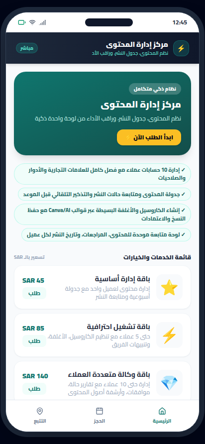
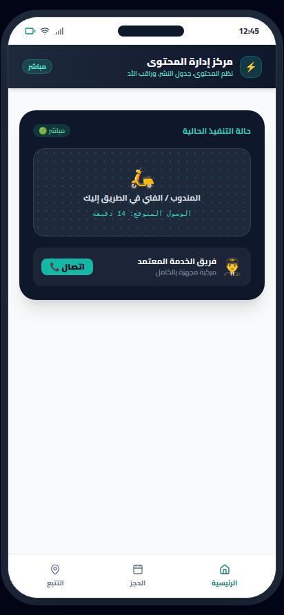
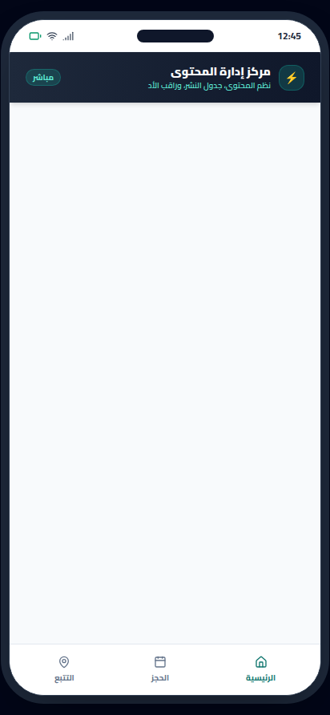

# مركز إدارة المحتوى (ContentOps Hub)


-orange?style=flat)


> **نظم المحتوى، جدول النشر، وراقب الأداء من لوحة واحدة ذكية**

---

## 📸 Real App Screenshots (لقطات حقيقية من التطبيق)

| الشاشة الرئيسية والخدمات | تفاصيل الحجز والتسعير | التتبع المباشر وحالة الطلب |
|:---:|:---:|:---:|
|  |  |  |

---

## 📱 Project Overview (نظرة عامة على المشروع)

هذا المنتج يحول مشروع إدارة حسابات التواصل الاجتماعي إلى منصة تشغيل منظمة تدعم فرق التسويق عبر دورة حياة كاملة للمحتوى: من التجهيز والمراجعة إلى الجدولة والمتابعة والأرشفة. القيمة المضافة هنا ليست فقط في تنظيم المهام، بل في تمكين فريق صغير من إدارة عدة عملاء بكفاءة عالية مع تقليل الأخطاء وتوحيد الهوية البصرية للمحتوى عبر الكاروسيل والأغلفة والأصول السريعة.

معماريًا، يُبنى الحل على Clean Architecture مع فصل واضح بين طبقة العرض، طبقة الاستخدامات، وطبقة البيانات، بحيث تكون كيانات مثل ContentClient وPublishingTask وDesignAsset مستقلة وقابلة للتوسع. يتم ربط النظام بسحابة خفيفة لحفظ الوسائط، مزامنة الحالات، وإرسال الإشعارات، مع سجل تدقيق للأحداث، وجدولة خلفية للمهام، وتدفق صلاحيات متعدد الأدوار يضمن سلامة التشغيل في بيئة وكالة أو فريق خدمات متعددة العملاء.

---

## ✨ Core Features (المميزات الرئيسية)

- **إدارة 10 حسابات عملاء مع فصل كامل للعلامات التجارية والأدوار والصلاحيات**
- **جدولة المحتوى ومتابعة حالات النشر والتذكير التلقائي قبل الموعد**
- **إنشاء الكاروسيل والأغلفة البسيطة عبر قوالب Canva/AI مع حفظ النسخ والاعتمادات**
- **لوحة متابعة موحدة للمحتوى، المراجعات، وتاريخ النشر لكل عميل**

---

## 🏛️ Clean Architecture Layers

```
sa.mostaql.contentopshub
├── data/
│   └── ContentClientRepository.kt          # Flow-based reactive data source
├── model/
│   └── ContentClientModels.kt              # Immutable business data structures
└── ui/
    ├── ContentClientViewModel.kt           # StateFlow UI state holder
    └── ContentClientScreens.kt             # Jetpack Compose Material 3 screens
```

---

## 🛡️ Architectural Invariants & Security Threats

### Invariants (القواعد الصارمة):
- **`clientIsolation`**: Rule: كل عميل يملك مساحة بيانات مستقلة، ولا يجوز مشاركة الأصول أو الجداول أو القوالب بين العملاء إلا عبر مكتبة موارد عامة غير حساسة.
- **`publishingStateMachine`**: Rule: حالة المنشور تنتقل فقط وفق تسلسل مضبوط: Draft -> InReview -> Approved -> Scheduled -> Published -> Archived، وأي تعديل على السعر أو الخطة يعيد احتساب الإجمالي قبل التأكيد.

### Threat Model (حماية البيانات والتهديدات):
- حماية بيانات العملاء والمحتوى غير المنشور من التسرب أو الوصول غير المصرح به
- منع التلاعب بحالات الجدولة أو إعادة إرسال نفس مهمة النشر أكثر من مرة

---

## 🚀 Build Instructions

```bash
# Clone the repository
git clone https://github.com/hmoushim0-cloud/app-1289280.git
cd app-1289280

# Assemble Debug APK
./gradlew assembleDebug
```

---

### 🌐 Live Showcase & Cloud Verification
- **Verified Showcase:** [https://hmoushim0-cloud.github.io/live-previews/?id=1289280](https://hmoushim0-cloud.github.io/live-previews/?id=1289280)
